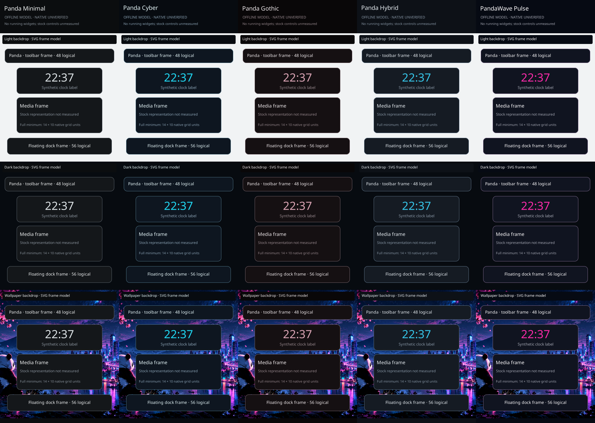

# Panda Desktop D4C3-S1 — native Plasma Style sources

Status: offline source milestone; native rendering and deployment unverified.
Base: integrated main `1a8b655334e2b906022a9c97ef169ed3aa930343` (PR #10).
The [D4C proposal](desktop-d4c-proposal.md), [D4B visual system](desktop-d4b.md)
and canonical `theme/panda/*/theme.toml` palettes remain authoritative.
No layout, applet, task pin, desktop count, theme-manager or installer changes.

S2 extends the current package inventory with the solid panel path; see the
[current S2 report](desktop-d4c3-s2.md). Counts below record the accepted S1 baseline.

## Package contract and source evidence

[Immutable source receipts](../../theme/panda/common/plasma_style/source-references.json)
pin 19 files by repository, tag, commit, tree, Git blob, SHA256 and byte length.
Raw upstream files are private validation inputs, excluded from the patch.

| Consumer | Pinned baseline | Reviewed contract |
| --- | --- | --- |
| libplasma | v6.8.1, `f46c05f2174e8cf35c8d46f4e8cd8fe7d595874e` | Plasma/Theme package paths, metadata, colors, effects and fallback |
| plasma-workspace | v6.8.1, `fb9b679a99078e68164b05b9cb3f5aaa6020222f` | desktop background hints/padding and panel behavior |
| KSvg | v6.31.0, `7367d0da1442deba4cabb2ad878b0a75f4b36a88` | FrameSvg parts, masks, margins, stretch and image selectors |

This uses the theme package's upstream `X-Plasma-API: "5.0"`; that value is
present in the pinned Breeze metadata and is distinct from the Plasma 6 applet
API. Files are directly under the package root, without a `contents/` wrapper.
KPlugin metadata gives each flavor a separate `panda-<flavor>-s1` ID.
The reviewed package structure is Plasma/Theme, whose default search root is
`plasma/desktoptheme`. This milestone does not copy packages there.

[BasicAppletContainer.qml](https://github.com/KDE/plasma-workspace/blob/fb9b679a99078e68164b05b9cb3f5aaa6020222f/components/containmentlayoutmanager/qml/BasicAppletContainer.qml#L73)
uses FrameSvg margins as container padding, chooses `widgets/background` for
StandardBackground and `widgets/translucentbackground` for TranslucentBackground.
A widget can request no standard background; S1 cannot force a frame onto it.

[FrameSvg](https://github.com/KDE/ksvg/blob/7367d0da1442deba4cabb2ad878b0a75f4b36a88/src/ksvg/framesvg.cpp#L928)
supports nine named sections, `mask-` sections, explicit `hint-*-margin`
dimensions and `hint-stretch-borders`. The SVGs supply all of these.
Original Panda geometry is generated; no Breeze artwork is copied.

| File in each of five packages | Native asset intent | Margin hint |
| --- | --- | --- |
| `widgets/background.svg` | standard desktop widget frame | 12 |
| `widgets/translucentbackground.svg` | deliberately opaque alias for translucent hint consumers | 12 |
| `widgets/panel-background.svg` | toolbar and dock frame | 8 |
| `dialogs/background.svg` | common popup/dialog frame | 16 |

Each asset has a nominal 12-unit corner radius, one-unit canonical `border`,
opaque canonical `surface`, nine visible sections and nine alpha-mask sections.
The curved outside corners are intentionally transparent. Interior coverage is
opaque; this is not a full rectangular alpha mask. Caps are 12 units and edges
stretch. Margin hints express content insets independently of the cap size.

The four other package files are `metadata.json`, `plasmarc`, `colors` and
the complete GPL-3.0-or-later license. There are 40 package files, including 20
SVGs. All flavors share one generator and structural digest. Canonical palettes
remain the sole color source; generated RGB values are derived outputs.

`plasmarc` retains `FallbackTheme=breeze-dark` and disables blur, background
contrast effects and adaptive transparency through the reviewed settings.
There are no shadow or blurred prefixes. Own base assets take precedence before
fallback when a selected variant is absent; see the pinned KSvg image-set
resolver. This small asset set leaves omitted controls to the theme fallback
chain. It does not establish that every fallback asset is opaque or visually
identical to S1. Breeze Dark is unchanged and remains the known-good rollback
choice; its presence must be confirmed before any later installation.

## Colors and contrast

The native `colors` file maps Window, View, Button, Selection, Tooltip,
Complementary and Header roles from existing semantic tokens.
Every selected foreground uses canonical `on_selection`. The initial candidate
mapped link/status tokens directly onto `selection`, producing 14 pairings
below 4.5:1. Those candidate failures remain enumerated in
[verification.json](previews/d4c3-s1/verification.json) as
`selection_candidate_advisories`; the initial report is also retained privately.
The corrected role mapping changes no canonical color. Selected status meanings
must still have icon/text cues; selected semantic hues are not preserved.

All current foreground/BackgroundNormal pairs meet 4.5:1, and focus/hover pairs
meet 3:1 in this static table. This is not a complete WCAG or runtime accessibility
audit: disabled effects, alternate backgrounds and widget-specific combinations
remain unmeasured.

| Flavor | Border / opaque surface | Wallpaper perimeter samples below 3:1 / 656 |
| --- | ---: | ---: |
| Minimal | 3.32:1 | 632 |
| Cyber | 4.03:1 | 479 |
| Gothic | 3.83:1 | 589 |
| Hybrid | 3.89:1 | 461 |
| PandaWave Pulse | 4.11:1 | 464 |

Every sampled edge passes against the fixed light/dark fixtures. Wallpaper edge
contrast fails for all five flavors, with minima near 1:1. These are recorded
advisories, not silently corrected colors or a claim of universal contrast.
The opaque interior remains readable against its own text colors. Before native
acceptance, assess boundary visibility over the actual wallpaper and decide
whether an explicitly approved treatment is needed.

## Offline previews and reproducibility



[Cyber comparison](previews/d4c3-s1/cyber-d4b-comparison.png) places the approved
D4B synthetic clock/media cards beside S1 frame-only models. Its bottom tiles
show the dialog frame (left) and opaque translucent-background alias (right).
The comparison uses the same palette and nominal radius. It deliberately makes
no claim about stock controls, artwork, type sizing or media fitting the card.
The five-column gallery provides the corresponding flavor comparison.

The renderer extracts actual generated SVG sections, rasterizes with librsvg,
then composes integer device-pixel seams using CPU Cairo. It never loads KSvg,
Qt, Plasma or an applet. Fractional-scale native rasterization remains untested.
Preview labels state offline model/native unverified. Sample clock text is
synthetic. The 48-high toolbar, 56-high dock and D4B 288×88 / 288×120 frames are
visual fixtures, not imposed native widget geometry.

The existing approved Panda Cyber wallpaper is hash-verified and embedded only
in PNG previews; it is not installed by the packages. Existing Noto Sans 2.015
(OFL) is hash-verified and shaped with Pango at 96 DPI without fallback.
Typography in these preview labels is measured by the existing D4B metrics
engine, not the running session's Qt/Kirigami font metrics.
See the existing [asset provenance](../../theme/panda/common/visual_assets.py).
The preview manifest records byte hashes and the verification report records
font/Cairo versions and D4B reference hashes. Reproducibility is verified within
this recorded toolchain; different raster/font library versions may change PNGs.

Run from this worktree using existing dependencies:

```fish
python3 -B theme/panda/common/plasma_style.py --check
python3 -B -m unittest discover -s tests -p 'test_plasma_style*.py' -v
fish bootstrap/validate.fish
```

`--generate` accepts only fixed repository artifact paths. It creates absent
outputs, preserves byte-identical files and refuses conflicts before generation
writes. It has no install/output-path option or runtime entry point. Directory
descriptors and binding checks prevent symlink redirection during writes.
A failure can leave newly created repository artifacts for inspection; it never
cleans unrelated objects or performs a live rollback.

The tests cover the five identical package structures, metadata, token-only
colors, malicious XML/SVG/resource refusal, margin and mask identities,
conflict/idempotence behavior and parent replacement. The raster matrix covers
480 frames: five flavors × four assets × six sizes × four scales
(100%, 125%, 150%, 200%). Sizes include 24×24, 288×88, 352×168, 1024×48,
352×56 and 303×119. Interior/seam alpha and selected mask scanlines are sampled;
this does not exhaust every pixel or native border-disable path.

## Supported styling versus remaining limits

| Through supported assets/settings | What S1 cannot establish or enforce |
| --- | --- |
| Frame silhouette, nominal radius, opaque fill, border and alpha mask | exact native corner pixels, fractional-scale seams and compositing |
| Explicit FrameSvg margin hints and stretched edges | applet minimum size, additional internal padding or border suppression |
| Standard, translucent-hint alias, panel and dialog asset paths | a frame for NoBackground widgets, all compact/full presentations |
| Native semantic color groups and effect preferences | every stock widget honoring every role or ignored color overrides |
| Explicit fallback theme | complete control/icon coverage or exact fallback opacity |
| Shared flavor geometry and semantic roles | per-card bespoke layout, typography, controls or icon placement |

Style assets do not set a font family/size, 48/56 panel height, Fit Content,
floating mode, alignment, dock gap, applet geometry, pins or desktop count.
They do not implement MPRIS, weather, CPU/RAM faces, sensors or data behavior.
CPU linechart and RAM horizontal bars and the approved face allowlist are
unchanged. The stock media full representation's 14×10 grid-unit minimum
remains a native measurement prerequisite; the compact D4B media card is not
claimed achievable.

Exact D4B inner controls, per-card type styles, bespoke gauges and compact/full
content changes may require custom Panda QML after native evidence and separate
approval. None is introduced here. Background/foreground tokens and frame
geometry can later be reused by Panda Command Center; no Command Center code
or layout applicator is part of S1.

## Proposed installation and rollback — not executed

1. Obtain separate authorization for native prerequisites, observation and a
   controlled style test. R0 runtime observation is still unauthorized. Keep
   D3B1A recovery and its unresolved findings separately gated.
2. Confirm the loaded stack, an existing Breeze Dark fallback, current style ID,
   relevant configuration preservation and an approved recovery procedure.
   Preserve applet identities, pins, activity/output bindings, desktop count and
   all unrelated desktop settings. Do not infer loaded versions from packages.
3. Review exact hashes and ownership; copy only the five uniquely named S1
   package directories to an explicitly approved user-local Plasma Theme root.
   Refuse existing conflicting IDs. Record every created object and parent
   binding. Installation does not authorize activation.
4. Activate one selected flavor only under a later scoped authorization. Measure
   standard/no-background consumers, popups, panel edges, 100–200% scales, text
   metrics, masks and media minimum size. Stop on identity/configuration drift,
   unreadable content, a frame seam or unexpected effect/service activation.
5. Rollback uses the recorded prior valid style ID through an operator-approved
   supported setting, or separately approved `breeze-dark` fallback. Do not
   restore entire Plasma configuration files, reset timestamps, clear caches,
   restart the session or claim recovery is proven. Remove only S1 objects whose
   creation identity remains verified, after confirming they are not active.

## Observed verification

- Complete suite: **328 tests passed** with isolated HOME/XDG.
  Baseline before S1: 314 passed. New focused coverage: 14 passed.
- Fish/package validator: **13 scripts**, **54 package entries**, bootstrap
  executable checks passed. No Fish or package manifest changes.
- 20 SVGs parse and match the restricted geometry/semantic/safety profile;
  five packages share an identical normalized structural digest.
- All 19 source payloads match the recorded SHA256, byte length, Git blob and
  immutable commit-tree membership. Report links resolve locally; upstream
  links point to immutable KDE commits.
- Independent-process generation reproduced all **49 generated artifacts**
  byte for byte; inode, mode, owner, size and mtime remained unchanged.
- Fresh final source review found no important confirmed defects.
- All 57 new review files passed whitespace checks, including the untracked
  patch content. The tracked diff and index remain empty.
- Six previous checkout HEADs, branches and status listings matched baseline.
  Sixteen prior untracked-file receipts plus the ignored approved specification
  matched bytes, metadata, xattrs and parent bindings. The already-modified
  tracked canary bootstrap had no initial byte receipt: only its modified status
  was recorded. This task did not edit it; exact before/after bytes are unverified.
- No live session query or configuration access, installation, activation,
  service start, D3B1A access, commit, push, merge or deployment was performed.

These results qualify the offline sources. Wallpaper contrast advisories,
native KSvg measurements and recovery/runtime authorization remain open.

## Change inventory and review boundary

New source/specification: `plasma_style.py`, `plasma_style/spec.json`,
`plasma_style/source-references.json`, `plasma_style_preview.py`.
New tests: `test_plasma_style.py`, `test_plasma_style_preview.py`.
Documentation: this report and `desktop-d4c3-s1-plan.md`.
Generated packages: five `theme/panda/plasma-styles/panda-*-s1/` directories,
each with the eight files listed above.
Previews: five individual PNGs, gallery PNG, Cyber comparison PNG,
`verification.json` and `manifest.json` under `previews/d4c3-s1/`.
Private raw source, preservation receipts, test logs and complete review patch
remain ignored local evidence. No previous milestone file is modified.
